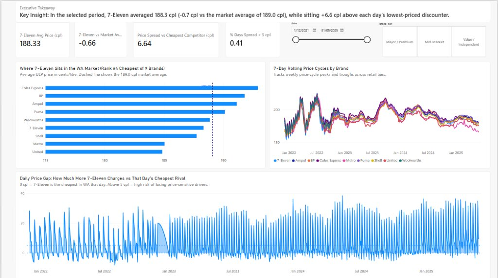
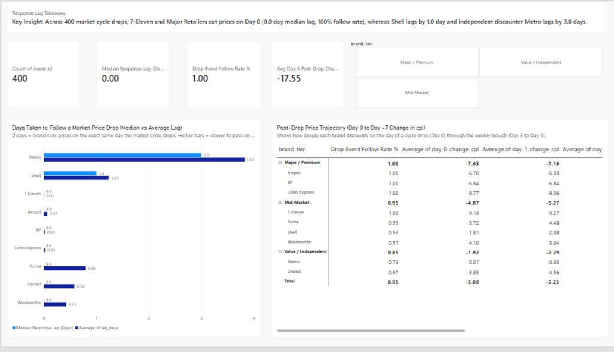

# Australian Fuel Market: Competitor Pricing & BI Pipeline

A modular Python ETL, competitor pricing analysis, weekly anomaly reporting, and **Microsoft Power BI (PL-300) Kimball Star Schema** pipeline built on 42 complete months of daily station-level retail fuel data from FuelWatch Western Australia (December 2021 to May 2025, covering **1,278 contiguous trading days** and **640,770 exact Unleaded Petrol (`ULP`) station-day observations** across 9 retail brands).

The project quantifies 7-Eleven's competitive positioning, weekly price-cycle behaviour (Tuesday trough discounting vs Wednesday restoration hikes), daily price spread relative to the cheapest major competitor, and response behaviour across 146 de-clustered market drop episodes.

---

## Key Commercial Findings

- **Brand Positioning (`181.6 cpl`, Rank #3 of 9 overall, #2 among major networks)**: Across all 1,278 trading days, 7-Eleven averaged `181.6 cpl` for regular Unleaded Petrol (`ULP`), pricing **`3.2 cpl` below the station-weighted WA market average (`184.8 cpl`)** and sitting behind only value discounters `Metro` (`179.1 cpl`, 2 to 7 stations) and `United` (`179.2 cpl`, ~42 stations).
- **Daily Spread vs Cheapest Major Competitor (`+3.1 cpl` mean, `0.5 cpl` median)**: Benchmarked against the 7 major multi-station networks (excluding micro-operator `Metro` and exited `Woolworths`), 7-Eleven priced **at or below the cheapest major rival on `46.2%` of all trading days (`591` of `1,278` days)**, and exceeded the `+5.0 cpl` risk threshold on `29.1%` of days (`+5.55 cpl` mean / `37.9%` of days when micro-operator `Metro` is included).
- **Weekly Price Cycle Dynamics (Tuesday Trough vs Wednesday Restoration Hike)**: The 4-year average spread masks a pronounced weekly price cycle:
  - **Tuesday Trough (`169.5 cpl`)**: 7-Eleven undercuts the cheapest major rival by **`-3.4 cpl`** and sits **`-7.3 cpl` below** the station-weighted market average (`176.8 cpl`).
  - **Wednesday Hike (`199.3 cpl`)**: Across 164 weekly restoration episodes, `Coles Express` (`99%`), `7-Eleven` (`98%`, averaging a `+33.8 cpl` Wednesday jump), `BP` (`98%`), and `Ampol` (`97%`) restore prices in lockstep on Wednesday, while `United` (`73%` same-day, `91%` within 1 day) and `Shell` (`71%`) lag by a day, causing 7-Eleven's spread vs the cheapest major rival to spike to **`+16.2 cpl` on Wednesdays** and **`+7.5 cpl` on Thursdays** before tapering through Monday (`-1.2 cpl`).
- **Same-Day Lockstep on Cycle Drops (`146` Discrete Drop Episodes)**: Across 146 de-clustered market drop episodes (defined on peer major brands excluding 7-Eleven, with a minimum 5-day gap between episodes), `7-Eleven`, `Ampol`, `BP`, and `Coles Express` all record a **`0.0` day median and mean lag (`100%` follow rate)**, whereas `United` (`95%` follow rate, `0.9d` mean lag), `Puma` (`88%`, `1.3d` mean lag), `Shell` (`85%`, `2.1d` mean lag), and `Metro` (`53%`, `4.5d` mean lag) respond more slowly.

---

## Methodological Definitions

1. **Exact Fuel Type Filter (`ULP` Only)**: Filters strictly to regular Unleaded Petrol (`PRODUCT_DESCRIPTION == "ULP"`), excluding Premium Unleaded (`PULP`, `95 RON`, `98 RON`), Diesel, and LPG so station-day observations are never distorted by higher-octane grades.
2. **Station-Weighted Market Average**: Daily market averages weight each brand's daily mean price by its active reporting station count on that day (`SUM(avg_price * station_count) / SUM(station_count)`).
3. **Major Network Benchmark vs All-Brand Panel**: Because station counts vary across brands (`Ampol` expands from ~83 to ~150 stations as `Coles Express` transitions; `Woolworths` exits after December 2022; `Metro` operates 2 to 7 sites), `dim_brand` includes an `is_major_network` flag separating the 7 major networks from `Metro` and `Woolworths`.
4. **Discrete Episode De-Clustering**: Consecutive days of cycle drops or restoration hikes are grouped into discrete episodes using a 5-day minimum separation window (`min_episode_gap_days = 5`), anchored on peer-brand movement excluding 7-Eleven.
5. **Market-Adjusted Weekly Anomaly Baseline**: The weekly report compares the current 7-day window against the strictly prior 56-day baseline (`[t-62, t-7]`) and subtracts the market-wide shift over the same window so macro fuel movements do not trigger false brand-level anomaly flags.

---

## Power BI Executive Dashboard (PL-300 Kimball Star Schema)

Interactive workbook: [`powerbi/Fuel_pricing_analysis.pbix`](powerbi/Fuel_pricing_analysis.pbix) | Data Model & DAX Reference: [`powerbi/POWER_BI_STAR_SCHEMA_GUIDE.md`](powerbi/POWER_BI_STAR_SCHEMA_GUIDE.md)

### Page 1: Executive Market Positioning & Spread Overview


### Page 2: Cycle Drop Response & Competitor Lag Analysis


### Page 3: Weekly Commercial Watchlist & Baseline Anomaly Monitor


### Kimball Dimensional Model View (`1:*` Star Schema)


---

## Repository Structure

```text
fuel-market-competitor-pricing-australia/
├── run_pipeline.py                      # Unified CLI entrypoint (all, ingest, analyse, report, export-star-schema)
├── pyproject.toml                       # Python package metadata and test configuration
├── requirements.txt                     # Pinned runtime dependencies
├── src/
│   ├── __init__.py                      # Public package exports
│   ├── config.py                        # Typed PipelineConfig dataclass, brand tiers, and chart theme
│   ├── ingestion.py                     # Raw CSV ingestion, exact ULP filter, outlier checks, Parquet ETL
│   ├── analysis.py                      # Positioning, weekly cycle profile, spread, and episode response lag
│   ├── reporting.py                     # Automated weekly briefing generator and market-adjusted anomaly detector
│   └── star_schema.py                   # Kimball Star Schema builder & Parquet/CSV exporter for Power BI
├── powerbi/
│   ├── Fuel_pricing_analysis.pbix       # Interactive Power BI executive dashboard workbook
│   └── POWER_BI_STAR_SCHEMA_GUIDE.md    # Kimball ER diagram, DAX measure library, and PL-300 report layout
├── tests/
│   └── test_pipeline.py                 # Automated unit & integration test suite (8 test cases)
├── notebooks/                           # Archived initial exploratory notebooks (superseded by src/)
├── outputs/                             # Generated visualisations, briefings, and Power BI dashboard views
│   ├── powerbi_01_executive_overview.jpg
│   ├── powerbi_02_competitor_response_lag.jpg
│   ├── powerbi_03_weekly_anomaly_watchlist.jpg
│   ├── powerbi_04_star_schema_model_view.png
│   ├── 01_market_positioning.png
│   ├── 02_price_spread.png
│   ├── 03_spread_distribution.png
│   ├── 04_response_lag.png
│   ├── 05_response_curves.png
│   ├── 06_7eleven_weekly_trend.png
│   ├── 07_weekly_price_cycle.png
│   └── weekly_report_2025_05_31.png
└── data/
    ├── raw/                             # 42 monthly FuelWatch CSV files (Dec 2021 to May 2025, local)
    ├── processed/                       # Cleaned station-level and daily brand Parquet/CSV files
    └── star_schema/                     # 6 Kimball Dimension & Fact tables (Parquet & CSV) for Power BI
```

---

## Quick Start & CLI Usage

### 1. Install Dependencies
```bash
python3 -m venv .venv
.venv/bin/pip install -r requirements.txt
```

### 2. Run the Full Pipeline
With the 42 monthly FuelWatch CSV files in `data/raw/`, execute the complete end-to-end workflow (ingestion, competitor & weekly cycle analysis, weekly report generation, and Power BI Star Schema export):

```bash
python3 run_pipeline.py all
```

Or run individual pipeline stages:

```bash
python3 run_pipeline.py ingest
python3 run_pipeline.py analyse
python3 run_pipeline.py report --report-date 2025-05-31 --historical-date 2023-06-30
python3 run_pipeline.py export-star-schema
```

### 3. Run Unit & Integration Tests (8 Tests)
```bash
python3 -m unittest discover -s tests -p "test_*.py" -v
```

---

## Data Source & Notes

**FuelWatch Western Australia**  
Department of Energy, Mines, Industry Regulation and Safety  
https://www.fuelwatch.wa.gov.au/retail/historic  
Licence: Creative Commons Attribution 4.0 (CC BY 4.0)

**Note on Brand Network Transitions (`Coles Express` & `Woolworths`)**:
- `Woolworths` (`Caltex Woolworths`) is present through December 2022 (`366` days) before rebranding to `EG Ampol` / `Ampol`.
- `Coles Express` maintained ~80 reporting stations across WA through early 2024 before rapidly transitioning sites to `Ampol` following Ampol's acquisition, with its last WA FuelWatch station observation occurring on 13 May 2025.
- The exploratory notebooks in `notebooks/` are preserved as an archive of initial prototyping and are superseded by the modular `src/` package.

---

## Stack

Python 3 · pandas · NumPy · Matplotlib · Polars / PyArrow · Power BI (Kimball Star Schema & DAX) · unittest

---

## Author

**Shreya Nagaraju**  
Master of Data Science, Monash University  
Microsoft Certified: Power BI Data Analyst Associate (PL-300)  
[LinkedIn](https://www.linkedin.com/in/shreya-nagaraju) · [GitHub](https://github.com/ShreyaNagaraju)
