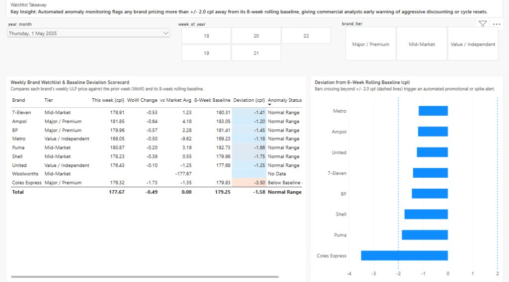
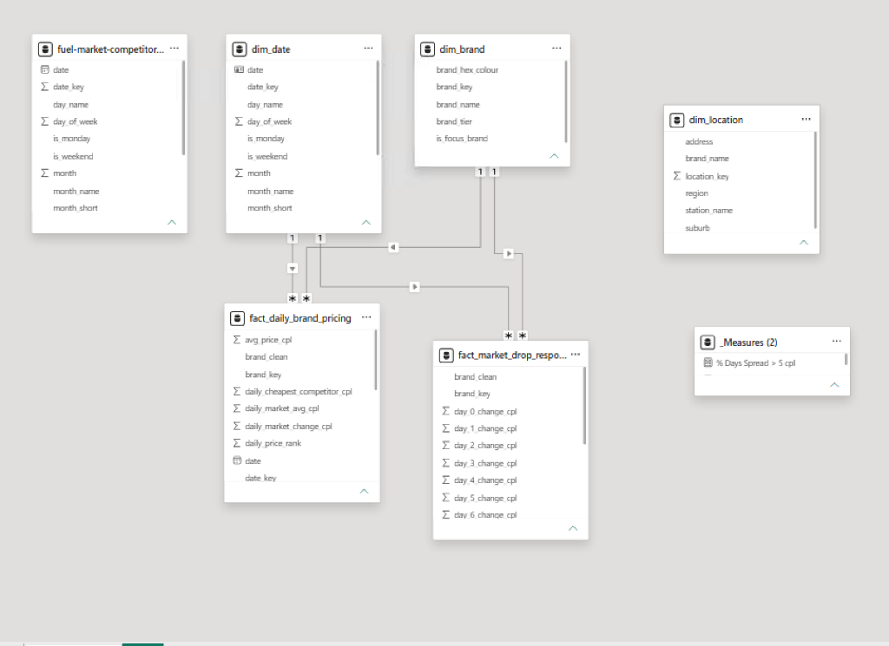

# Australian Fuel Market: Competitor Pricing & BI Pipeline

A production-grade Python ETL, competitor pricing analysis, automated weekly anomaly reporting, and **Microsoft Power BI (PL-300) Kimball Star Schema** pipeline built on three years of daily station-level retail fuel data from FuelWatch Western Australia (December 2021 to May 2025, covering 1,247 trading days and over 1.06 million station-day Unleaded Petrol observations).

The project quantifies 7-Eleven's competitive positioning, daily price spread relative to the cheapest competitor, and automated response behaviour across 400 market drop events, delivering both reproducible Python visualisations and dimensional Star Schema tables ready for Power BI Desktop.

---

## Key Commercial Findings

- **7-Eleven averaged 188.3 cpl** across the analysis period, ranking 4th cheapest out of 9 major brands: a consistent mid-market position sitting 0.6 cpl below the 9-brand market average (`188.9 cpl`).
- **On an average day, 7-Eleven priced 6.6 cpl above the cheapest competitor** in the WA market, holding parity or the cheapest position on 30.1% of trading days while pricing more than 5 cpl above the lowest competitor on 41.1% of days.
- **7-Eleven recorded a median response lag of 0.0 days** across 400 significant market drop events (single-day market declines of 3.0+ cpl), following 100% of drops within 14 days: the joint fastest response rate of any brand.
- **By day 3 after a market drop, 7-Eleven's price fell an average of 17.5 cpl** below its pre-event level: the steepest trough decline of any brand in the dataset.
- **Cycle-Aware Margin Optimisation**: The empirical evidence demonstrates a strategy that leads the market down aggressively at the cycle trough to capture volume while holding a mid-market premium during the recovery phase to protect retail margin.

---

## Power BI Executive Dashboard (PL-300 Kimball Star Schema)

### Page 1: Executive Market Positioning & Spread Overview


### Page 2: Cycle Drop Response & Competitor Lag Analysis


### Page 3: Weekly Commercial Watchlist & Baseline Anomaly Monitor


### Kimball Dimensional Model View (`1:*` Star Schema)


---

## Production Architecture

```text
fuel-market-competitor-pricing-australia/
├── run_pipeline.py                      # Unified CLI entrypoint (all, ingest, analyse, report, export-star-schema)
├── pyproject.toml                       # Python package metadata and pytest configuration
├── requirements.txt                     # Pinned runtime dependencies
├── src/
│   ├── __init__.py                      # Public package exports
│   ├── config.py                        # Typed PipelineConfig dataclass, brand tiers, and chart theme
│   ├── ingestion.py                     # Raw CSV ingestion, schema normalisation, outlier filtering, Parquet ETL
│   ├── analysis.py                      # Positioning, 7-day rolling spread, and 400-event response lag engine
│   ├── reporting.py                     # Automated weekly briefing generator and 8-week baseline anomaly detector
│   └── star_schema.py                   # Kimball Star Schema builder & Parquet/CSV exporter for Power BI
├── powerbi/
│   └── POWER_BI_STAR_SCHEMA_GUIDE.md    # Kimball ER diagram, DAX measure library, and PL-300 report layout
├── tests/
│   └── test_pipeline.py                 # Automated unit & integration test suite (7 end-to-end test cases)
├── notebooks/                           # Archived exploratory Jupyter notebooks (Notebooks 1, 2, and 3)
├── outputs/                             # Generated visualisations, briefings, and Power BI dashboard views
│   ├── powerbi_01_executive_overview.jpg
│   ├── powerbi_02_competitor_response_lag.jpg
│   ├── powerbi_03_weekly_anomaly_watchlist.jpg
│   ├── powerbi_04_star_schema_model_view.png
│   ├── 01_market_positioning.png
│   ├── 02_price_spread.png
│   ├── 03_spread_distribution.png
│   ├── 04_response_lag.png
│   ├── 05_response_curves.png
│   ├── 06_7eleven_weekly_trend.png
│   └── weekly_report_2025_05_31.png
└── data/
    ├── raw/                             # Monthly FuelWatch CSV files (downloaded locally)
    ├── processed/                       # Cleaned station-level and daily brand Parquet/CSV files
    └── star_schema/                     # Kimball Dimension & Fact tables (Parquet & CSV) for Power BI
```

---

## Quick Start & CLI Usage

### 1. Install Dependencies
```bash
python3 -m venv .venv
.venv/bin/pip install -r requirements.txt
```

### 2. Run the Full Production Pipeline
Once your monthly FuelWatch CSV files are placed in `data/raw/`, execute the complete end-to-end workflow (ingestion, competitor analysis, weekly report generation, and Power BI Star Schema export) with a single command:

```bash
python3 run_pipeline.py all
```

Or run individual pipeline stages:

```bash
# Stage 1: Ingest raw CSVs, normalise schema & brands, remove outliers, and write Parquet files
python3 run_pipeline.py ingest

# Stage 2: Run competitor positioning, daily spread, and market-drop response lag analyses (Charts 01 to 05)
python3 run_pipeline.py analyse

# Stage 3: Generate weekly executive briefing, chart, and longitudinal trend view (Chart 06)
python3 run_pipeline.py report --report-date 2025-05-31 --historical-date 2023-06-30

# Stage 4: Export Kimball Star Schema tables (Dim_Date, Dim_Brand, Dim_Location, Fact tables) for Power BI
python3 run_pipeline.py export-star-schema
```

### 3. Run in Demo Mode (Synthetic Data)
To test the entire pipeline immediately without downloading the 40 raw FuelWatch CSV files, use `--demo`. This generates realistic synthetic WA FuelWatch station data and writes all outputs to `data/demo/` without overwriting the historical charts in `outputs/`:

```bash
python3 run_pipeline.py --demo
```

### 4. Run Unit & Integration Tests
```bash
python3 -m unittest discover -s tests -p "test_*.py" -v
```

---

## Pipeline Modules

### 1. Data Ingestion & Validation (`src/ingestion.py`)
Loads monthly CSV files from FuelWatch WA, standardises column names across multi-year format changes, filters to Unleaded Petrol (`ULP`), removes data-entry outliers below `70.0 cpl` or above `350.0 cpl`, normalises retail brand names across naming variations, validates date coverage, and persists both station-level (`fuelwatch_clean.parquet`) and daily brand-average (`daily_brand_averages.parquet`) datasets.

### 2. Competitor Pricing Analytics (`src/analysis.py`)
- **Analysis 1 (Market Positioning)**: Computes 7-day rolling average prices and brand-level summary rankings across all 9 major brands (`01_market_positioning.png`).
- **Analysis 2 (Daily Price Spread)**: Tracks the daily cpl spread between 7-Eleven and the cheapest competitor (`02_price_spread.png`, `03_spread_distribution.png`).
- **Analysis 3 (Competitor Response Lag)**: Identifies 400 market drop events (days where the market average drops by `>= 3.0 cpl`) and measures how many days each brand takes to drop by at least `2.0 cpl` within a 14-day window (`04_response_lag.png`), alongside 7-day post-drop trajectory curves (`05_response_curves.png`).

### 3. Automated Weekly Reporting (`src/reporting.py`)
Produces a repeatable weekly market snapshot and plain-English commercial briefing for any target date, flagging brands that deviate by more than `2.0 cpl` from their 8-week rolling baseline (`weekly_report_YYYY_MM_DD.txt` and `.png`), plus a longitudinal Monday trend tracker (`06_7eleven_weekly_trend.png`).

### 4. Power BI Kimball Star Schema Exporter (`src/star_schema.py`)
Transforms the processed pricing data into a Kimball dimensional model (`dim_date`, `dim_brand`, `dim_location`, `fact_daily_brand_pricing`, and `fact_market_drop_response`) exported as both Parquet and CSV files. See [`powerbi/POWER_BI_STAR_SCHEMA_GUIDE.md`](powerbi/POWER_BI_STAR_SCHEMA_GUIDE.md) for the ER diagram, DAX measures, and report design.

---

## Data Source

**FuelWatch Western Australia**  
Department of Energy, Mines, Industry Regulation and Safety  
https://www.fuelwatch.wa.gov.au/retail/historic  
Licence: Creative Commons Attribution 4.0

**Note on Coles Express**: Coles Express began rebranding its WA network to Ampol from 2023 onward following Ampol's acquisition of Coles' fuel retail business. Coles Express station counts thin progressively through 2024 and are absent in some 2025 weeks, reflecting a real market brand transition rather than a pipeline error.

---

## Stack

Python 3 · pandas · NumPy · SciPy · Matplotlib · PyArrow · Power BI (Star Schema & DAX) · unittest

---

## Author

**Shreya Nagaraju**  
Master of Data Science, Monash University  
Microsoft Certified: Power BI Data Analyst Associate (PL-300)  
[LinkedIn](https://www.linkedin.com/in/shreya-nagaraju) · [GitHub](https://github.com/ShreyaNagaraju)
