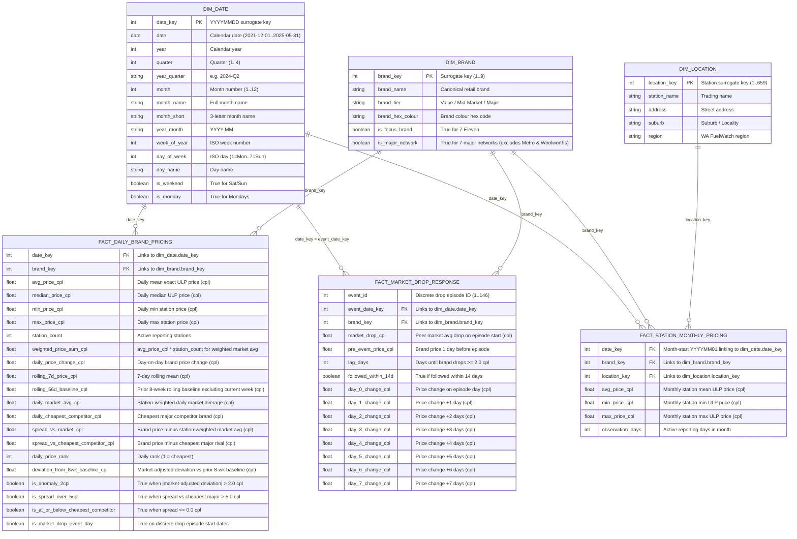

# Power BI (PL-300) Kimball Star Schema & DAX Specification

This guide documents the **Kimball Dimensional Model (Star Schema)**, **Power Query parameterised ingestion**, **DAX measure library**, and **4-page executive report layout** exported by [`src/star_schema.py`](../src/star_schema.py) for Microsoft Power BI Desktop.

---

## 1. Star Schema Architecture (6 Tables, Zero Orphan Tables, Zero Duplicate Fact Columns)

Running `python3 run_pipeline.py export-star-schema` (or `python3 run_pipeline.py all`) generates three Dimension tables and three Fact tables in `data/star_schema/`:



---

## 2. Power BI Model Hygiene & Relationships

1. **Disable Auto Date/Time**:
   - In Power BI Desktop, go to **File -> Options and settings -> Options -> Current File -> Data Load** and **uncheck `Auto date/time`**.
   - Fact tables (`fact_daily_brand_pricing`, `fact_market_drop_response`, `fact_station_monthly_pricing`) carry only integer surrogate keys (`date_key`, `event_date_key`, `brand_key`, `location_key`) and zero duplicate date/text columns.
2. **Delete Stray Tables & Rename `_Measures`**:
   - Delete any duplicate/stray table (`fuel-market-competitor-pricing-`) and ensure the measures table is named `_Measures` (not `_Measures (2)`).
3. **Configure 7 Active `1:*` Single-Direction Relationships**:
   - `dim_date[date_key]` (`1`) -> `fact_daily_brand_pricing[date_key]` (`*`)
   - `dim_brand[brand_key]` (`1`) -> `fact_daily_brand_pricing[brand_key]` (`*`)
   - `dim_date[date_key]` (`1`) -> `fact_market_drop_response[event_date_key]` (`*`)
   - `dim_brand[brand_key]` (`1`) -> `fact_market_drop_response[brand_key]` (`*`)
   - `dim_date[date_key]` (`1`) -> `fact_station_monthly_pricing[date_key]` (`*`)
   - `dim_brand[brand_key]` (`1`) -> `fact_station_monthly_pricing[brand_key]` (`*`)
   - `dim_location[location_key]` (`1`) -> `fact_station_monthly_pricing[location_key]` (`*`)
4. **Mark `dim_date` as Date Table** using `dim_date[date]`, and sort `month_name`/`month_short` by `month` and `day_name` by `day_of_week`.

---

## 3. Core DAX Measures Library (Bug-Free, Blank-Guarded, Anchored Windows)

### A. Core Pricing, Station-Weighted Market Average & Benchmarks
```dax
Avg Retail Price (cpl) = 
AVERAGE(fact_daily_brand_pricing[avg_price_cpl])

Market Avg Price (cpl) = 
CALCULATE(
    DIVIDE(
        SUM(fact_daily_brand_pricing[weighted_price_sum_cpl]),
        SUM(fact_daily_brand_pricing[station_count])
    ),
    ALL(dim_brand)
)

7-Eleven Avg Price (cpl) = 
CALCULATE(
    [Avg Retail Price (cpl)],
    KEEPFILTERS(dim_brand[is_focus_brand] = TRUE())
)

7-Eleven vs Market Avg (cpl) = 
VAR FocusPx = [7-Eleven Avg Price (cpl)]
VAR MktPx = [Market Avg Price (cpl)]
RETURN
    IF(ISBLANK(FocusPx) || ISBLANK(MktPx), BLANK(), FocusPx - MktPx)

Price Spread vs Market Avg (cpl) = 
VAR BrandPx = [Avg Retail Price (cpl)]
VAR MktPx = [Market Avg Price (cpl)]
RETURN
    IF(ISBLANK(BrandPx) || ISBLANK(MktPx), BLANK(), BrandPx - MktPx)

Price Spread vs Cheapest Competitor (cpl) = 
CALCULATE(
    AVERAGE(fact_daily_brand_pricing[spread_vs_cheapest_competitor_cpl]),
    dim_brand[is_focus_brand] = TRUE()
)

% Days Spread > 5 cpl = 
VAR TotalDays = CALCULATE(
    COUNTROWS(fact_daily_brand_pricing),
    dim_brand[is_focus_brand] = TRUE()
)
VAR HighSpreadDays = CALCULATE(
    COUNTROWS(fact_daily_brand_pricing),
    dim_brand[is_focus_brand] = TRUE(),
    fact_daily_brand_pricing[is_spread_over_5cpl] = TRUE()
)
RETURN
    DIVIDE(HighSpreadDays, TotalDays, 0)

% Days At or Below Cheapest Rival = 
VAR TotalDays = CALCULATE(
    COUNTROWS(fact_daily_brand_pricing),
    dim_brand[is_focus_brand] = TRUE()
)
VAR ParityDays = CALCULATE(
    COUNTROWS(fact_daily_brand_pricing),
    dim_brand[is_focus_brand] = TRUE(),
    fact_daily_brand_pricing[is_at_or_below_cheapest_competitor] = TRUE()
)
RETURN
    DIVIDE(ParityDays, TotalDays, 0)
```

### B. Anchored 7-Day Windows & Market-Adjusted Anomaly Detection
*(Anchors "This Week" to the final 7 days of the selected date context and excludes the current week from the 8-week baseline, adjusting for market-wide shifts)*
```dax
This Week Price (cpl) = 
VAR MaxDate = MAX(dim_date[date])
RETURN
    CALCULATE(
        [Avg Retail Price (cpl)],
        DATESINPERIOD(dim_date[date], MaxDate, -7, DAY)
    )

Prior Week Price (cpl) = 
VAR MaxDate = MAX(dim_date[date])
RETURN
    CALCULATE(
        [Avg Retail Price (cpl)],
        DATESINPERIOD(dim_date[date], MaxDate - 7, -7, DAY)
    )

WoW Price Change (cpl) = 
VAR CurrWk = [This Week Price (cpl)]
VAR PrevWk = [Prior Week Price (cpl)]
RETURN
    IF(ISBLANK(CurrWk) || ISBLANK(PrevWk), BLANK(), CurrWk - PrevWk)

Rolling 8-Week Baseline (cpl) = 
VAR MaxDate = MAX(dim_date[date])
RETURN
    IF(
        ISBLANK([This Week Price (cpl)]),
        BLANK(),
        CALCULATE(
            [Avg Retail Price (cpl)],
            DATESINPERIOD(dim_date[date], MaxDate - 7, -56, DAY)
        )
    )

Deviation from 8-Week Baseline (cpl) = 
VAR MaxDate = MAX(dim_date[date])
VAR BrandCurr = [This Week Price (cpl)]
VAR BrandBase = [Rolling 8-Week Baseline (cpl)]
VAR MktCurr = CALCULATE([Market Avg Price (cpl)], DATESINPERIOD(dim_date[date], MaxDate, -7, DAY))
VAR MktBase = CALCULATE([Market Avg Price (cpl)], DATESINPERIOD(dim_date[date], MaxDate - 7, -56, DAY))
VAR MarketShift = MktCurr - MktBase
RETURN
    IF(
        ISBLANK(BrandCurr) || ISBLANK(BrandBase),
        BLANK(),
        (BrandCurr - BrandBase) - MarketShift
    )

Anomaly Status Flag = 
VAR Dev = [Deviation from 8-Week Baseline (cpl)]
RETURN
    SWITCH(
        TRUE(),
        ISBLANK(Dev), "Inactive in Period",
        Dev > 2.0, "Above Market Baseline (> +2.0 cpl)",
        Dev < -2.0, "Below Market Baseline (< -2.0 cpl)",
        "Normal Range"
    )
```

### C. Discrete Drop Episode & Weekly Cycle Measures
```dax
Total Drop Episodes = 
DISTINCTCOUNT(fact_market_drop_response[event_id])

Median Response Lag (Days) = 
MEDIAN(fact_market_drop_response[lag_days])

Drop Event Follow Rate % = 
VAR TotalEvents = COUNTROWS(fact_market_drop_response)
VAR FollowedEvents = CALCULATE(
    COUNTROWS(fact_market_drop_response),
    fact_market_drop_response[followed_within_14d] = TRUE()
)
RETURN
    DIVIDE(FollowedEvents, TotalEvents, 0)

Avg Day 3 Post-Drop Change (cpl) = 
AVERAGE(fact_market_drop_response[day_3_change_cpl])

Avg Daily Price Change (cpl) = 
AVERAGE(fact_daily_brand_pricing[daily_price_change_cpl])
```

### D. Dynamic Executive Takeaway Banners (Zero Hardcoded Numbers, No `+-` Sign Bug)
```dax
Executive Takeaway = 
"Key Insight: In the selected period, 7-Eleven averaged "
    & FORMAT([7-Eleven Avg Price (cpl)], "0.0") & " cpl ("
    & FORMAT([7-Eleven vs Market Avg (cpl)], "+0.0;-0.0;0.0")
    & " cpl vs the station-weighted market average of "
    & FORMAT([Market Avg Price (cpl)], "0.0") & " cpl), and priced at or below the cheapest major rival on "
    & FORMAT([% Days At or Below Cheapest Rival], "0.0%")
    & " of days (mean spread "
    & FORMAT([Price Spread vs Cheapest Competitor (cpl)], "+0.0;-0.0;0.0") & " cpl)."

Response Lag Takeaway = 
VAR EpCount = [Total Drop Episodes]
VAR SeLag = CALCULATE([Median Response Lag (Days)], dim_brand[is_focus_brand] = TRUE())
VAR SeFollow = CALCULATE([Drop Event Follow Rate %], dim_brand[is_focus_brand] = TRUE())
VAR ShellLag = CALCULATE([Median Response Lag (Days)], dim_brand[brand_name] = "Shell")
VAR MetroFollow = CALCULATE([Drop Event Follow Rate %], dim_brand[brand_name] = "Metro")
RETURN
    "Key Insight: Across " & FORMAT(EpCount, "#,##0")
    & " de-clustered price-drop episodes, 7-Eleven moves in same-day lockstep with Ampol, BP, and Coles Express ("
    & FORMAT(SeLag, "0.0") & "d median lag, " & FORMAT(SeFollow, "0%")
    & " follow rate), whereas Shell lags by " & FORMAT(ShellLag, "0.0")
    & "d and independent Metro follows only " & FORMAT(MetroFollow, "0%") & " of episodes."

Weekly Cycle Takeaway = 
VAR TueSpread = CALCULATE([Price Spread vs Cheapest Competitor (cpl)], dim_date[day_of_week] = 2)
VAR WedSpread = CALCULATE([Price Spread vs Cheapest Competitor (cpl)], dim_date[day_of_week] = 3)
VAR TuePrice = CALCULATE([7-Eleven Avg Price (cpl)], dim_date[day_of_week] = 2)
VAR WedPrice = CALCULATE([7-Eleven Avg Price (cpl)], dim_date[day_of_week] = 3)
RETURN
    "Key Insight: WA retail fuel follows a sharp weekly cycle: 7-Eleven bottoms on Tuesday at "
    & FORMAT(TuePrice, "0.0") & " cpl (" & FORMAT(TueSpread, "+0.0;-0.0;0.0")
    & " cpl vs cheapest major rival) before leading the Wednesday restoration hike to "
    & FORMAT(WedPrice, "0.0") & " cpl (" & FORMAT(WedSpread, "+0.0;-0.0;0.0") & " cpl spread)."

Watchlist Takeaway = 
VAR EndDateStr = FORMAT(MAX(dim_date[date]), "dd MMM yyyy")
VAR FlaggedBrands = COUNTROWS(
    FILTER(
        VALUES(dim_brand[brand_name]),
        ABS([Deviation from 8-Week Baseline (cpl)]) > 2.0
    )
)
RETURN
    "Key Insight: For the 7-day window ending " & EndDateStr & ", "
    & FORMAT(FlaggedBrands, "0")
    & " brand(s) deviated by more than +/- 2.0 cpl from their prior 8-week baseline after adjusting for market-wide movement."
```

---

## 4. Recommended 4-Page PL-300 Executive Dashboard Layout

1. **Page 1 (`Executive Overview`)**:
   - Top Banner: `Executive Takeaway`
   - 4 KPI Cards: `7-Eleven Avg Price (cpl)` (`181.6 cpl`), `7-Eleven vs Market Avg (cpl)` (`-3.2 cpl`), `Price Spread vs Cheapest Competitor (cpl)` (`+3.1 cpl`), `% Days At or Below Cheapest Rival` (`46.2%`)
   - Visuals: Brand Positioning Horizontal Bar Chart, 7-Day Rolling Price Line Chart, and Daily Spread Area Chart (`1,278` contiguous days with December 2022 restored).
2. **Page 2 (`Weekly Price Cycle & Hike Leadership`)**:
   - Top Banner: `Weekly Cycle Takeaway`
   - Left Visual: Average Price by Day of Week (`dim_date[day_name]` sorted by `day_of_week`) comparing `7-Eleven Avg Price (cpl)` (`169.5 cpl` Tuesday trough -> `199.3 cpl` Wednesday peak) vs `Market Avg Price (cpl)`.
   - Right Visual: `Price Spread vs Cheapest Competitor (cpl)` by Day of Week (`-3.4 cpl` on Tuesday vs `+16.2 cpl` on Wednesday and `+7.5 cpl` on Thursday).
3. **Page 3 (`Cycle Drop Response Lag`)**:
   - Top Banner: `Response Lag Takeaway`
   - 4 KPI Cards: `Total Drop Episodes` (`146`), 7-Eleven `Median Response Lag (Days)` (`0.0d`), 7-Eleven `Drop Event Follow Rate %` (`100.0%`), 7-Eleven `Avg Day 3 Post-Drop Change (cpl)` (`-16.8 cpl`).
   - Left Visual: Median & Mean Response Lag by Brand.
   - Right Visual: Post-Drop Trajectory Matrix (`Day 0` through `Day +7`).
4. **Page 4 (`Weekly Anomaly Watchlist`)**:
   - Top Banner: `Watchlist Takeaway`
   - Slicers: `dim_date[year_month]`, `dim_date[week_of_year]`, `dim_brand[brand_tier]`.
   - Left Table: Anchored 7-day `This Week Price (cpl)`, `WoW Price Change (cpl)`, `Price Spread vs Market Avg (cpl)`, `Rolling 8-Week Baseline (cpl)`, `Deviation from 8-Week Baseline (cpl)` (blank-guarded so inactive brands never show `-177.67`), and `Anomaly Status Flag`.
   - Right Visual: Market-Adjusted Deviation Bar Chart with `+/- 2.0 cpl` constant lines.
