# Power BI (PL-300) Kimball Star Schema & DAX Specification

This guide documents the **Kimball Dimensional Model (Star Schema)**, **Power Query ingestion steps**, **DAX measure library**, and **3-page executive report layout** exported by [`src/star_schema.py`](../src/star_schema.py) for Microsoft Power BI Desktop.

---

## 1. Star Schema Architecture

Running `python3 run_pipeline.py export-star-schema` (or `python3 run_pipeline.py all`) generates five clean Parquet and CSV tables in `data/star_schema/`:

```mermaid
erDiagram
    DIM_DATE ||--o{ FACT_DAILY_BRAND_PRICING : "date_key"
    DIM_BRAND ||--o{ FACT_DAILY_BRAND_PRICING : "brand_key"
    DIM_DATE ||--o{ FACT_MARKET_DROP_RESPONSE : "date_key = event_date_key"
    DIM_BRAND ||--o{ FACT_MARKET_DROP_RESPONSE : "brand_key"
    DIM_BRAND ||--o{ DIM_LOCATION : "brand_name"

    DIM_DATE {
        int date_key PK "YYYYMMDD surrogate key"
        date date "Calendar date"
        int year "Calendar year"
        int quarter "Quarter (1..4)"
        string year_quarter "e.g. 2024-Q2"
        int month "Month number (1..12)"
        string month_name "Full month name"
        string month_short "3-letter month name"
        string year_month "YYYY-MM"
        int week_of_year "ISO week number"
        int day_of_week "ISO day (1=Mon..7=Sun)"
        string day_name "Day name"
        boolean is_weekend "True for Sat/Sun"
        boolean is_monday "True for Mondays"
    }

    DIM_BRAND {
        int brand_key PK "Surrogate key (1..9)"
        string brand_name "Canonical retail brand"
        string brand_tier "Value / Mid-Market / Major"
        string brand_hex_colour "Brand colour hex code"
        boolean is_focus_brand "True for 7-Eleven"
    }

    DIM_LOCATION {
        int location_key PK "Station surrogate key"
        string station_name "Trading name"
        string address "Street address"
        string suburb "Suburb / Locality"
        string region "WA FuelWatch region"
        string brand_name "Canonical retail brand"
    }

    FACT_DAILY_BRAND_PRICING {
        int date_key FK "Links to dim_date.date_key"
        int brand_key FK "Links to dim_brand.brand_key"
        float avg_price_cpl "Daily mean ULP price (cpl)"
        float median_price_cpl "Daily median ULP price (cpl)"
        float min_price_cpl "Daily min station price (cpl)"
        float max_price_cpl "Daily max station price (cpl)"
        int station_count "Active reporting stations"
        float rolling_7d_price_cpl "7-day rolling mean (cpl)"
        float rolling_56d_baseline_cpl "8-week rolling baseline (cpl)"
        float daily_market_avg_cpl "9-brand daily average (cpl)"
        float daily_cheapest_competitor_cpl "Cheapest non-7-Eleven brand (cpl)"
        float spread_vs_market_cpl "Brand price minus market avg (cpl)"
        float spread_vs_cheapest_competitor_cpl "Brand price minus cheapest comp (cpl)"
        int daily_price_rank "Daily rank (1 = cheapest)"
        float deviation_from_8wk_baseline_cpl "Current minus 8-week baseline (cpl)"
        boolean is_anomaly_2cpl "True when |deviation| > 2.0 cpl"
        boolean is_spread_over_5cpl "True when spread vs cheapest > 5.0 cpl"
        boolean is_at_or_below_cheapest_competitor "True when spread <= 0.0 cpl"
        boolean is_market_drop_event_day "True when market drops >= 3.0 cpl"
    }

    FACT_MARKET_DROP_RESPONSE {
        int event_id "Drop event sequence number"
        int event_date_key FK "Links to dim_date.date_key"
        int brand_key FK "Links to dim_brand.brand_key"
        float market_drop_cpl "Single-day market avg drop (cpl)"
        float pre_event_price_cpl "Brand price 1 day before drop"
        int lag_days "Days until brand drops >= 2.0 cpl"
        boolean followed_within_14d "True if followed within 14 days"
        float day_0_change_cpl "Price change on event day (cpl)"
        float day_1_change_cpl "Price change +1 day (cpl)"
        float day_2_change_cpl "Price change +2 days (cpl)"
        float day_3_change_cpl "Price change +3 days (cpl)"
        float day_4_change_cpl "Price change +4 days (cpl)"
        float day_5_change_cpl "Price change +5 days (cpl)"
        float day_6_change_cpl "Price change +6 days (cpl)"
        float day_7_change_cpl "Price change +7 days (cpl)"
    }
```



---

## 2. Power BI Model Relationships (Model View)

In Power BI Desktop, configure the following **1-to-Many (`1:*`) single-direction** relationships:

1. `dim_date[date_key]` (`1`) -> `fact_daily_brand_pricing[date_key]` (`*`) (Active)
2. `dim_brand[brand_key]` (`1`) -> `fact_daily_brand_pricing[brand_key]` (`*`) (Active)
3. `dim_date[date_key]` (`1`) -> `fact_market_drop_response[event_date_key]` (`*`) (Active)
4. `dim_brand[brand_key]` (`1`) -> `fact_market_drop_response[brand_key]` (`*`) (Active)

Mark `dim_date` as the official **Date Table** using the `dim_date[date]` column.

---

## 3. Core DAX Measures Library

Create a dedicated `_Measures` table in Power BI Desktop and add the following DAX measures:

### Pricing & Market Positioning Measures
```dax
Avg Retail Price (cpl) = 
AVERAGE(fact_daily_brand_pricing[avg_price_cpl])

Market Avg Price (cpl) = 
CALCULATE(
    AVERAGE(fact_daily_brand_pricing[avg_price_cpl]),
    ALLSELECTED(dim_brand)
)

7-Eleven Avg Price (cpl) = 
CALCULATE(
    [Avg Retail Price (cpl)],
    dim_brand[brand_name] = "7-Eleven"
)

Cheapest Competitor Price (cpl) = 
AVERAGEX(
    VALUES(dim_date[date_key]),
    CALCULATE(
        MIN(fact_daily_brand_pricing[avg_price_cpl]),
        dim_brand[brand_name] <> "7-Eleven"
    )
)

Price Spread vs Cheapest Competitor (cpl) = 
[7-Eleven Avg Price (cpl)] - [Cheapest Competitor Price (cpl)]

Price Spread vs Market Avg (cpl) = 
[Avg Retail Price (cpl)] - [Market Avg Price (cpl)]
```

### Time Intelligence & Anomaly Detection Measures
```dax
Prior Week Price (cpl) = 
CALCULATE(
    [Avg Retail Price (cpl)],
    DATEADD(dim_date[date], -7, DAY)
)

WoW Price Change (cpl) = 
[Avg Retail Price (cpl)] - [Prior Week Price (cpl)]

Rolling 8-Week Baseline (cpl) = 
CALCULATE(
    [Avg Retail Price (cpl)],
    DATESINPERIOD(
        dim_date[date],
        MAX(dim_date[date]),
        -56,
        DAY
    )
)

Deviation from 8-Week Baseline (cpl) = 
[Avg Retail Price (cpl)] - [Rolling 8-Week Baseline (cpl)]

Anomaly Status Flag = 
VAR Dev = [Deviation from 8-Week Baseline (cpl)]
RETURN
    SWITCH(
        TRUE(),
        ISBLANK(Dev), "No Data",
        Dev > 2.0, "Above Baseline (> +2.0 cpl)",
        Dev < -2.0, "Below Baseline (< -2.0 cpl)",
        "Normal Range"
    )

% Days Spread > 5 cpl = 
VAR TotalDays = COUNTROWS(
    FILTER(
        fact_daily_brand_pricing,
        RELATED(dim_brand[brand_name]) = "7-Eleven"
    )
)
VAR HighSpreadDays = COUNTROWS(
    FILTER(
        fact_daily_brand_pricing,
        RELATED(dim_brand[brand_name]) = "7-Eleven"
            && fact_daily_brand_pricing[is_spread_over_5cpl] = TRUE()
    )
)
RETURN
    DIVIDE(HighSpreadDays, TotalDays, 0)
```

### Competitor Response Lag Measures
```dax
Median Response Lag (Days) = 
MEDIAN(fact_market_drop_response[lag_days])

Drop Event Follow Rate % = 
VAR TotalEvents = COUNTROWS(fact_market_drop_response)
VAR FollowedEvents = CALCULATE(
    COUNTROWS(fact_market_drop_response),
    fact_market_drop_response[followed_within_14d] = TRUE()
)
RETURN
    DIVIDE(FollowedEvents, TotalEvents, 0)

Avg Day 3 Post-Drop Change (cpl) = 
AVERAGE(fact_market_drop_response[day_3_change_cpl])
```

---

## 4. Recommended 3-Page PL-300 Executive Dashboard Layout

### Page 1: Executive Market Positioning & Spread Overview
* **Top KPI Cards**:
  1. `7-Eleven Avg Price (cpl)` (`188.3 cpl`, Rank 4 of 9)
  2. `Price Spread vs Market Avg (cpl)` (`-0.6 cpl`)
  3. `Price Spread vs Cheapest Competitor (cpl)` (`+6.6 cpl`)
  4. `% Days Spread > 5 cpl` (`41.1%`)
* **Primary Visual**: Line chart of `rolling_7d_price_cpl` by `dim_date[date]` and `dim_brand[brand_name]` with `dim_brand[brand_tier]` slicer.
* **Bottom Visual**: Area chart of `spread_vs_cheapest_competitor_cpl` over time with a `0.0 cpl` parity reference line.

### Page 2: Cycle Drop Response & Competitor Lag Analysis
* **Top KPI Cards**:
  1. Total Market Drop Events (`400`)
  2. 7-Eleven `Median Response Lag (Days)` (`0.0 days`)
  3. 7-Eleven `Drop Event Follow Rate %` (`100.0%`)
  4. 7-Eleven `Avg Day 3 Post-Drop Change (cpl)` (`-17.5 cpl`)
* **Left Visual**: Horizontal bar chart of `Median Response Lag (Days)` by `dim_brand[brand_name]`.
* **Right Visual**: Multi-line response curve (`day_0_change_cpl` through `day_7_change_cpl`) comparing trough depth across brands.

### Page 3: Weekly Commercial Watchlist & Anomaly Monitor
* **Slicers**: `dim_date[year_month]`, `dim_brand[brand_tier]`, and `Anomaly Status Flag`.
* **Matrix Visual**: Brand-by-Week watchlist displaying `Avg Retail Price (cpl)`, `WoW Price Change (cpl)`, `Rolling 8-Week Baseline (cpl)`, `Deviation from 8-Week Baseline (cpl)`, and conditional formatting icons flagging deviations exceeding `+/- 2.0 cpl`.

